> 🛠️ Faço software que resolve problema de gente de verdade: comércio local, automação do dia a dia, IoT e segurança.
>
> 📍 Paraná, Brasil · 🔭 Agora: **Tá Seguro?**, um app que ajuda idosos a reconhecer golpes no WhatsApp.

---

## 🆕 Último lançamento

<!-- ULTIMO:INICIO -->
<table align="center"><tr><td align="center" width="900">
<h3>✨ Tá Seguro?</h3>

🛡️ Detector de golpes para idosos: cole a mensagem ou o print e descubra se é golpe. Roda 100% no celular

 

 

</td></tr></table>
<!-- ULTIMO:FIM -->

---

## 🚀 Projetos em destaque

<table>
<tr>
<td width="50%" valign="top">
<h3 align="center">🛡️ Tá Seguro?</h3>

 

Detector de golpes para idosos: cole a mensagem ou o print e o app explica, em letra grande, se é golpe. Roda 100% no celular — a mensagem não sai do aparelho.

   

</td>
<td width="50%" valign="top">
<h3 align="center">🤖 Claude Monitor</h3>

Dashboard que monitora tokens e custo da API Anthropic por período de cobrança. Alertas via Telegram + histórico SQLite.

  

</td>
</tr>
<tr>
<td width="50%" valign="top">
<h3 align="center">🖥️ PDV Local</h3>

Ponto de venda desktop 100% offline com Electron + SQLite. Caixa, estoque, vendas e relatórios — sem servidor.

  

</td>
<td width="50%" valign="top">
<h3 align="center">📡 Monitor ESP32</h3>

Monitora latência e qualidade da internet com ESP32. Alertas via Telegram + portal web responsivo + OTA.

 

</td>
</tr>
<tr>
<td width="50%" valign="top">
<h3 align="center">💳 Maquininha Web</h3>

Terminal POS no navegador com Mercado Pago — cartão e PIX. Webhook, painel admin e API REST.

 

</td>
<td width="50%" valign="top">
<h3 align="center">🍱 Cantina da Bea</h3>

 

Site completo para cantina/restaurante — cardápio, galeria, WhatsApp. Mobile-first, zero dependências.

 

</td>
</tr>
<tr>
<td width="50%" valign="top">
<h3 align="center">📥 Telegram Collector</h3>

Bot Python que monitora grupos no Telegram, baixa arquivos e os categoriza automaticamente por tipo.

 

</td>
<td width="50%" valign="top">
<h3 align="center">🌐 Portfólio</h3>

 

Portfólio com Three.js 3D, partículas, animações GSAP e suporte a toque no celular.

  

</td>
</tr>
</table>

---

## 🕒 Lançados recentemente

<!-- RECENTES:INICIO -->
| Projeto | O que faz | Linguagem | Lançado | Links |
|---|---|:---:|:---:|:---:|
| **[Impulso](https://github.com/BAZZUKA-ROOT/impulso)** | 📣 Gera posts com IA (imagem + legenda) nas cores da sua marca e agenda no Instagram e Facebook |  | 26/10/2026 | <a href="https://github.com/BAZZUKA-ROOT/impulso">código</a> |
| **[Comparou](https://github.com/BAZZUKA-ROOT/comparou)** | 🔎 Comparador de preços multi-loja com radar diário, histórico e alerta quando o preço cai |  | 26/10/2026 | <a href="https://github.com/BAZZUKA-ROOT/comparou">código</a> |
| **[SecScan](https://github.com/BAZZUKA-ROOT/secscan)** | 🔐 Scanner de segurança sem dependências: segredos vazados, RLS do Supabase, CORS aberto, SQL injection e CVEs recentes |  | 26/10/2026 | <a href="https://github.com/BAZZUKA-ROOT/secscan">código</a> |
| **[Claude Monitor](https://github.com/BAZZUKA-ROOT/claude-monitor)** | Monitor de uso da API Anthropic com alertas Telegram e dashboard web |  | 25/10/2026 | <a href="https://github.com/BAZZUKA-ROOT/claude-monitor">código</a> |
| **[Portfólio](https://github.com/BAZZUKA-ROOT/portfolio-bazzuka)** | Portfolio profissional full-stack com Three.js 3D, animacoes GSAP e suporte mobile |  | 25/10/2026 | <a href="https://github.com/BAZZUKA-ROOT/portfolio-bazzuka">código</a> · <a href="https://bazzuka-root.github.io/portfolio-bazzuka/">demo</a> |
| **[Site Restaurante Template](https://github.com/BAZZUKA-ROOT/site-restaurante-template)** | 🍽️ Template HTML responsivo para restaurante — menu, galeria, dark mode automático e pedido pelo WhatsApp. Zero dependências |  | 25/10/2026 | <a href="https://github.com/BAZZUKA-ROOT/site-restaurante-template">código</a> · <a href="https://bazzuka-root.github.io/site-restaurante-template/">demo</a> |
<!-- RECENTES:FIM -->

🤖 Esta seção e o “Último lançamento” se atualizam sozinhos a cada 2 horas.

---

## 📊 Números

---

## ⚡ Stack

---

*"Código que resolve problema real vale mais que código perfeito no papel."*

